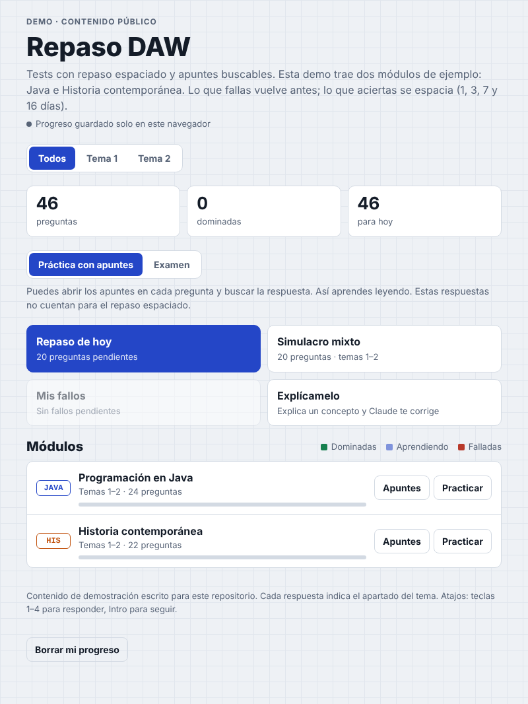
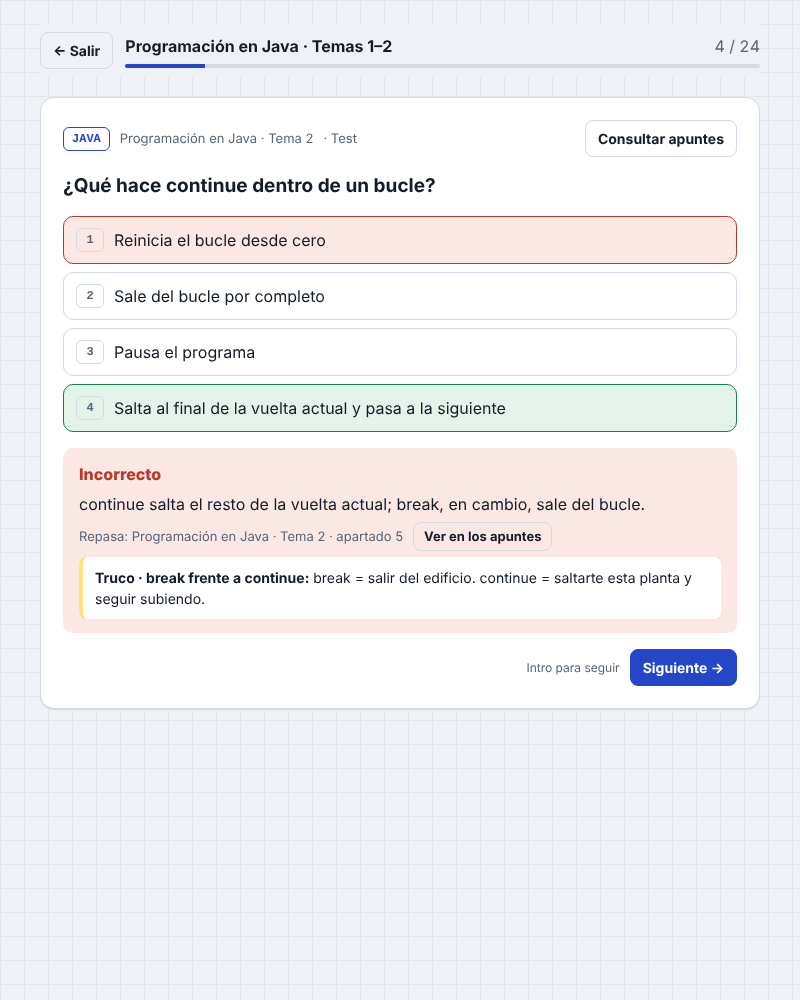
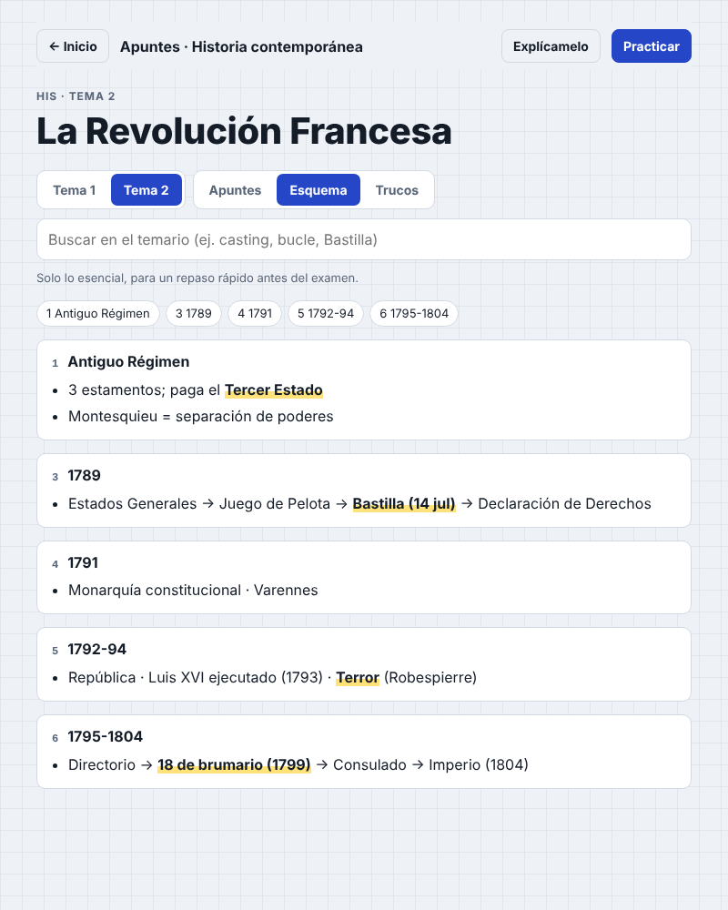

# Repaso DAW · app de estudio con repaso espaciado

App web para estudiar con tests y apuntes buscables. La hice para preparar los exámenes del ciclo de **Desarrollo de Aplicaciones Web**. Este repositorio trae **contenido de demo** (Java e Historia contemporánea) escrito desde cero; el temario real del ciclo no se incluye.

**Demo en vivo:** https://juangadi7.github.io/repaso-daw/



## Qué hace

- **Repaso espaciado (sistema Leitner):** lo que fallas vuelve antes y lo que aciertas se espacia a 1, 3, 7 y 16 días.
- **Cuatro tipos de ejercicio:** test, ordenar elementos, respuesta numérica y escribir XML bien formado (validado en el navegador con `DOMParser`).
- **Dos modos:** *práctica* (puedes abrir los apuntes en cada pregunta) y *examen* (sin apuntes; solo este cuenta para el repaso).
- **Apuntes con buscador**, con vistas de apuntes, esquema y trucos mnemotécnicos. Cada pregunta enlaza al apartado donde está la respuesta.
- **Explícamelo (técnica Feynman):** explicas un concepto con tus palabras y una IA lo corrige comparándolo con los apuntes. *Solo funciona cuando la página se abre dentro de Claude; en GitHub Pages muestra un aviso.*
- Progreso guardado en `localStorage`, modo oscuro automático y atajos de teclado (1–4 para responder, Intro para seguir).

| Pregunta | Apuntes |
|---|---|
|  |  |

## Tecnología

HTML, CSS y JavaScript sin frameworks, dependencias ni proceso de build.

```
index.html   estructura
styles.css   estilos (variables CSS, tema claro/oscuro)
app.js       lógica: Leitner, render de vistas, validación XML, búsqueda
data.js      contenido: módulos, preguntas, apuntes, esquemas, trucos
```

## Usar tu propio temario

Sustituye `data.js` respetando la misma estructura (está documentada al principio del fichero). No hace falta tocar `app.js`.

## Ejecutar en local

```bash
python -m http.server 8000
# abre http://localhost:8000
```

## Licencia

MIT
